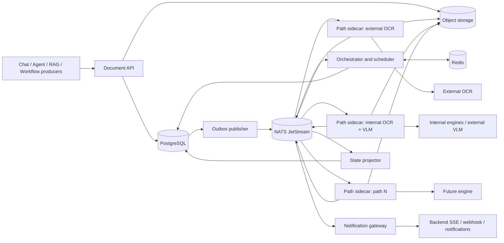

# Document Processing Orchestration Service

Status: Target architecture for v1

Last updated: 2026-09-02

Audience: backend, platform, ML/OCR, frontend, SRE, security, and product teams

This document defines the target v1 architecture and rollout direction. The runnable v0.1 slice
and its current public behavior are documented in `README.md`; v1 durability, security, API, and
event requirements below are not claims about the in-process v0.1 implementation.

## 1. Executive summary

This document specifies an asynchronous document-processing platform that accepts work from chat uploads, agents, RAG ingestion, and workflows; ranks that work fairly; and routes it to one of `N` OCR execution paths.

An execution path can be an external OCR API, an internal OCR engine, an internal pipeline that also consumes an external VLM quota, or a future service with different capability, cost, latency, compliance, and capacity constraints.

The platform has two principal runtime layers:

- The **orchestration layer** owns admission, durable job state, priority and fairness, route selection, retries, fallback, cancellation, reconciliation, and lifecycle events.
- A **path sidecar** sits next to each OCR adapter or worker pool. It translates generic execution commands into engine-specific calls, enforces local capacity, reports health and progress, heartbeats leases, uploads artifacts, and normalizes results and errors.

The recommended baseline stack is:

- **PostgreSQL** for authoritative jobs, attempts, state transitions, policies, and the transactional outbox.
- **NATS JetStream** for durable commands and fan-out lifecycle events.
- **Redis** for rebuildable priority indexes, distributed token buckets, short-lived capacity leases, and circuit-breaker state.
- **S3-compatible object storage** for source documents and output artifacts. Document bytes never travel through NATS, Redis, or ordinary database rows.

The system offers at-least-once delivery with idempotent effects. It does not claim impossible end-to-end exactly-once execution across third-party OCR APIs. Duplicate delivery and, in rare failures, duplicate paid computation are handled explicitly through idempotency keys, attempt fencing, compare-and-set state transitions, and reconciliation.

## 2. Goals

The system must:

1. Expose one asynchronous job contract to all document-producing features.
2. Protect every execution path from request, page, token, concurrency, memory, and hardware overload.
3. Prefer the best eligible path while respecting data policy, quality, deadline, cost, health, and capacity.
4. Support `N` independently deployed paths without adding path-specific scheduling code.
5. Give interactive jobs low queue latency without starving bulk ingestion.
6. Preserve accepted jobs through process and node failures.
7. Produce ordered, versioned state changes that backends can relay to a UI and notification systems.
8. Allow safe retries, path fallback, cancellation, replay, and operator intervention.
9. Make routing decisions explainable and observable.
10. Scale horizontally by region and scheduling shard.

## 3. Non-goals

The first version does not:

- Define OCR model internals, prompt design, or document-understanding workflows after OCR.
- Store source binaries in the message bus or database.
- Promise strict global FIFO ordering. Priority, fairness, eligibility, and capacity intentionally reorder work.
- Promise that cancellation can stop a third-party request already accepted by a provider.
- Dynamically choose a different engine for every page in v1. The model permits work-unit routing, but a document stays on one path by default for consistent output.
- Expose NATS or Redis directly to browsers or product backends.
- Use broker delivery as the canonical job status. PostgreSQL is authoritative.

## 4. Assumptions and sizing inputs

The architecture is valid without fixed traffic numbers, but deployment sizing requires the following inputs:

- Documents per second at average and peak, by producer type.
- Pages and bytes per document at p50, p95, and p99.
- Required queue-time and completion-time objectives by workload class.
- Allowed file types, languages, and maximum dimensions.
- Tenant count and acceptable noisy-neighbor behavior.
- External OCR and VLM quotas: requests/minute, pages/minute, tokens/minute, concurrent jobs, daily spend, and burst rules.
- Internal compute inventory: CPU, RAM, GPU model, VRAM, model replicas, and warm-up time.
- Data-residency regions, retention rules, and whether external processors are allowed per tenant.
- Whether the organization already operates Kafka or NATS as a supported platform.

Until measurements replace them, the spec uses four workload classes:

| Producer | Default class | Typical shape | Default objective |
|---|---|---|---|
| In-chat upload | `interactive` | Low frequency, user waiting | Lowest queue latency |
| Workflow | `workflow` | Variable, may block automation | Meet declared deadline |
| RAG ingestion | `standard` | Sustained, medium-to-high volume | Predictable throughput |
| Agent | `bulk` | Bursty backfills and large corpora | Cheapest safe throughput |

These are policy inputs, not hard-coded facts. A producer cannot obtain unlimited priority merely by sending `interactive`; tenant entitlements and server-side policy determine the effective class.

## 5. Terminology

- **Job**: the user-visible request to process one source document.
- **Work unit**: a schedulable part of a job. V1 normally has one OCR work unit per job; later versions may split by page range or stage.
- **Attempt**: one fenced execution of a work unit on one path.
- **Path**: a routable OCR capability backed by one adapter/worker pool and its sidecars.
- **Path definition**: durable configuration describing capabilities, policy, cost, limits, and dispatch subject.
- **Sidecar**: the generic execution-control process deployed alongside a path-specific adapter or engine worker.
- **Lease**: time-bounded ownership of an assignment, capacity slot, or quota reservation.
- **Artifact**: immutable input or output object in object storage.
- **Lifecycle event**: an immutable notification of a committed state transition.
- **Command**: a request for a component to attempt an action. A command can be redelivered.

## 6. Architectural principles

1. **Durable state before events.** A state transition and its outbox entry commit in one PostgreSQL transaction; publication happens afterward.
2. **Events wake and inform; state decides.** Consumers may use events for low latency, but query canonical state when correctness depends on the current value.
3. **Separate ordering from scheduling.** JetStream preserves and distributes events. Redis maintains mutable priority and quota state. Neither substitutes for the other.
4. **Payloads by reference.** Events carry object references, hashes, sizes, and metadata, never document bytes or extracted document text.
5. **At-least-once plus idempotency.** Every handler must tolerate duplicate, delayed, and out-of-order messages.
6. **One home region per job.** All state transitions and scheduling for a job occur in its data-residency region.
7. **Hard constraints before scoring.** Compliance and capability are eligibility gates, not score penalties.
8. **Pull capacity where practical.** A path declares free capacity before receiving work. This is safer than dispatching against stale utilization snapshots.
9. **Fail closed on policy; degrade safely on acceleration.** If authorization or residency cannot be evaluated, reject or pause. If Redis scheduling indexes are lost, rebuild them from PostgreSQL.
10. **Explain every route.** Store the policy version, candidate exclusions, chosen path, and score components with the attempt.

## 7. System context



## 8. Component responsibilities

### 8.1 Document API

The API:

- Authenticates callers and resolves tenant, region, producer, and allowed policies.
- Creates upload grants or accepts a bounded streaming upload and writes it directly to object storage.
- Validates idempotency, basic metadata, size, and supported media type.
- Creates the job, initial work unit, audit event, and outbox record transactionally.
- Returns `202 Accepted` with a stable job ID and status/event URLs.
- Supports status, cancellation, controlled retry, and artifact access.

The API does not wait for OCR and does not call OCR providers directly.

### 8.2 Preflight service

Preflight is asynchronous for all but trivial metadata checks. It:

- Verifies the object hash and actual media type.
- Performs malware scanning and decompression-bomb checks.
- Extracts page count, dimensions, encryption status, and language hints when cheap.
- Rejects unsupported or dangerous inputs.
- Estimates work cost such as pages, pixels, OCR tokens, and memory.
- Creates page-range work units only when the configured path or document size requires it.

Preflight commits validation metadata and emits `queued` or terminal `rejected`; `validating` remains visible until that transaction completes.

### 8.3 Orchestrator and scheduler

The orchestrator owns:

- Admission and queue policy after preflight.
- Per-tenant fairness, priority aging, deadlines, and queue caps.
- Eligibility filtering and route scoring.
- Distributed quota reservation and capacity matching.
- Attempt creation and fenced assignment commands.
- Retry, fallback, cancellation, timeout, and dead-letter policy.
- Rebuilding Redis indexes from authoritative queued rows.

It never invokes an OCR SDK directly. All engine-specific behavior belongs behind a sidecar/adapter contract.

#### 8.3.1 Replaceable policy decision point

Policy decisions are replaceable behind three strict operations: admission classification, route
ordering, and failure disposition. The built-in decision point evaluates a versioned declarative
snapshot; an embedding application may supply a customer engine with the same JSON-compatible
input and output models.

The decision point has no mutation authority. The orchestrator filters hard-ineligible paths before
route evaluation and validates every returned path and disposition before reserving capacity or
changing state. Attempt ceilings, conditional transitions, fencing, provider-outcome uncertainty,
artifact-before-success, and terminal-state behavior are orchestration invariants and cannot be
weakened by policy.

Every accepted job stores its admission policy identity and effective scheduling parameters. Every
attempt stores the route policy identity and bounded explanation. A failed attempt is durably
recorded as pending policy input before failure evaluation, so decision-point unavailability cannot
silently cause another execution.

The normative v0.1 decision vocabulary and replacement behavior are defined in
[`policy.md`](policy.md).

### 8.4 Path sidecar

A sidecar is deployed with each external-provider adapter deployment or each internal engine worker pod. A pool contains one or more identical sidecars sharing a durable command consumer.

The sidecar:

- Registers a path instance and periodically advertises capability and available slots.
- Pulls commands addressed to its `path_id` only when it has local capacity.
- Atomically claims an attempt using `attempt_id` and `fencing_token` before invoking an engine. The claim is a narrow internal compare-and-set against authoritative state; a rejected duplicate is acknowledged without execution.
- Downloads the input using a short-lived scoped object grant.
- Converts the generic request to the provider/engine-specific form.
- Enforces local concurrency, memory, GPU, and process limits even if global scheduling is wrong.
- Refreshes the attempt lease and emits coarse progress.
- Uploads normalized outputs before reporting success.
- Maps provider errors into the common error taxonomy.
- Emits usage measurements for quota reconciliation and cost accounting.
- Stops accepting work while unhealthy or draining.

The sidecar must not:

- Re-rank global work or bypass the orchestrator.
- Treat message receipt as proof that an attempt is still current.
- Publish source text, credentials, or provider payloads in events.
- Commit a result after its lease or fencing token has been superseded.

For an internal OCR path that calls an external VLM, the sidecar has two enforcement layers: a local semaphore for hardware/model capacity and a globally reserved Redis token bucket for VLM requests/tokens. Both must succeed before the attempt runs.

### 8.5 State projector

The state projector consumes attempt events and performs conditional PostgreSQL transitions. It is the single logical writer for asynchronous attempt results, though it may have many instances partitioned by job ID.

Every update checks:

- The event ID has not already been applied.
- The attempt is the current attempt for the work unit.
- The fencing token matches.
- The requested transition is legal from the current state.
- The event version is newer than the last applied version.

It writes the new state, immutable job event, and new outbox messages in one transaction.

### 8.6 Reconciler

The reconciler periodically finds and repairs stalled state:

- Accepted jobs with unpublished outbox entries.
- Queued jobs missing from Redis indexes.
- Reserved or running attempts with expired leases.
- Sidecars that disappeared while owning work.
- Jobs whose all work units are terminal but whose aggregate state is not.
- Webhook deliveries stuck beyond their lease.
- Redis quota reservations whose attempt is terminal.

Reconciliation is required correctness machinery, not an optional cleanup job.

### 8.7 Notification gateway

The notification gateway consumes public lifecycle events and delivers them to:

- A backend subscription over server-sent events or an internal WebSocket gateway.
- Registered webhooks for server-to-server integration.
- Product notification services for completion/failure alerts.

It applies tenant authorization, redaction, deduplication, and delivery retry. Browsers never connect to JetStream.

## 9. Technology decisions

### 9.1 Decision summary

| Concern | Choice | Why |
|---|---|---|
| Authoritative workflow state | PostgreSQL | Transactions, constraints, conditional updates, audit queries, mature recovery |
| Event and command transport | NATS JetStream | Durable consumers, explicit acknowledgement/redelivery, subject-based routing to dynamic paths, low latency, modest operational surface |
| Priority and fairness index | Redis sorted sets and hashes | Efficient mutable ordering and atomic server-side selection |
| Distributed quotas | Redis token buckets/semaphores | Fast shared counters with atomic Lua/function execution and TTLs |
| Binary/artifact storage | S3-compatible object store | Cheap durable large-object storage, checksums, lifecycle policies, scoped access |
| Schema definitions | JSON Schema with CloudEvents-compatible envelope | Language-neutral contracts and easy backend/UI consumption |
| Internal synchronous calls | HTTP/gRPC for fenced attempt claim, queries, scoped artifact grants, and health | Keep the correctness handshake narrow while lifecycle propagation remains asynchronous |

### 9.2 NATS JetStream versus Kafka versus Redis Streams

No broker supplies the required global, mutable, fair priority queue. Broker choice is therefore about command delivery, fan-out events, replay, and operations—not priority ranking.

| Criterion | NATS JetStream | Apache Kafka | Redis Streams |
|---|---|---|---|
| Durable delivery and replay | Strong with file-backed replicated streams and durable consumers | Strong; designed as a partitioned retained log | Available, but retention and durability share the Redis operational envelope |
| Dynamic route addressing | Excellent via hierarchical subjects and filtered consumers | Usually requires topic/partition conventions or a dispatcher | Key/stream conventions are possible but become application-managed |
| Per-job ordering | Preserve by publishing through a job-owned subject/sequence and enforcing versions | Native within a keyed partition | Native within one stream; cross-stream ordering is application-owned |
| Very large retained event history and analytics ecosystem | Good for operational retention | Best fit | Usually not the first choice |
| Operational weight | Moderate | Highest, unless already a managed platform | Lowest incremental cost if Redis is already required |
| Priority queue | No; use Redis scheduler | No; use Redis scheduler | Sorted sets can implement it, Streams alone do not |

**Decision:** use NATS JetStream for the greenfield baseline. Its subjects map naturally to `doc.cmd.execute.<path_id>` and let each path pool consume only its commands. Use JetStream, not fire-and-forget Core NATS, for all workflow commands and lifecycle events.

Choose Kafka instead when one of the following is already true:

- Kafka is an organization-supported managed platform and NATS would be a new operational burden.
- The event stream must feed a large existing Kafka analytics/connect ecosystem.
- The event log itself requires very long retention and high-throughput reprocessing beyond the operational workflow history held in PostgreSQL.
- Measured event throughput or retention exceeds the approved JetStream envelope.

If Kafka is selected, the contracts in this spec remain unchanged, but commands require a deliberate dispatch convention: managed topics per path family, or a dispatcher that converts a common assignment topic to path-local delivery. Do not deploy Kafka and NATS together in v1 merely to avoid making this choice.

Redis Streams are acceptable for a small single-region prototype, but they are not the baseline durable bus. Redis is already on the scheduling hot path; coupling long event retention and queue recovery to the same cluster increases the blast radius. Redis Pub/Sub is prohibited for workflow messages because disconnected consumers lose messages.

### 9.3 PostgreSQL versus a database queue

PostgreSQL can safely claim queue-like rows with `FOR UPDATE SKIP LOCKED`, which is useful for a prototype, index rebuilding, and controlled recovery. It is not the normal high-churn priority index because frequent score changes, fairness scans, and quota checks would add contention to the system of record. Normal production behavior pauses new dispatch when Redis is unavailable because shared quotas cannot be enforced safely.

Redis remains rebuildable acceleration. A job is never considered accepted solely because it exists in Redis.

### 9.4 Redis availability and durability

Use a dedicated highly available Redis deployment, not a cache shared with unrelated product features. Enable persistence appropriate to the service's quota risk and monitor replication lag.

If Redis is unavailable:

- Stop new dispatches by default; accepted jobs remain queued in PostgreSQL.
- Continue safe status reads and event delivery.
- Let already running attempts finish.
- Rebuild ready indexes and leased state after recovery.
- Restore vendor token buckets conservatively rather than assuming a full bucket. A per-path policy may permit a low emergency rate when the provider has harmless limits.

### 9.5 Why not a workflow engine in v1

Temporal is a strong option for durable multi-step application workflows, timers, and retries. It does not remove the need for global fair scheduling, path-capability matching, provider quotas, artifact storage, or backend lifecycle events. Using it in this first design would leave those hard parts in Redis/PostgreSQL while adding another durable control plane and a second representation of job state.

Do not add Temporal in v1. Re-evaluate this decision if document processing grows into long-lived, branched workflows with human approvals, compensation steps, or many independently retryable transformations. If adopted later, Temporal owns per-job workflow progression; the scheduler still owns cross-job fairness and scarce-resource routing. There must remain one authoritative public state projection.

## 10. Storage model

The following is a logical model; exact column types and normalization may vary.

### 10.1 `document_job`

Key fields:

- `job_id` (UUIDv7 or equivalent time-sortable opaque ID)
- `tenant_id`, `producer_type`, `client_reference`
- `idempotency_key_hash`
- `home_region`, `data_classification`, `residency_policy_id`
- `source_artifact_id`, `source_sha256`, `media_type`, `bytes`, `pages`
- `requested_workload_class`, `effective_workload_class`
- `deadline_at`, `max_cost`, `quality_floor`
- `state`, `state_version`, `progress_percent`
- `policy_version`, `created_at`, `updated_at`, `terminal_at`
- `result_manifest_artifact_id`, `terminal_error_code`

Unique constraint: `(tenant_id, idempotency_key_hash)` for the configured idempotency retention period.

### 10.2 `work_unit`

- `work_unit_id`, `job_id`, `kind`
- `page_start`, `page_end`, `input_artifact_id`
- `required_capabilities` JSON/document
- `state`, `state_version`, `eligible_at`
- `current_attempt_id`, `attempt_count`
- `estimated_pages`, `estimated_pixels`, `estimated_vlm_tokens`
- `created_at`, `updated_at`

### 10.3 `attempt`

- `attempt_id`, `work_unit_id`, `attempt_number`
- `path_id`, `path_revision`, `sidecar_instance_id`
- `fencing_token` (monotonically increasing per work unit)
- `state`, `state_version`
- `lease_expires_at`, `last_heartbeat_at`
- `reservation_id`, `reservation_estimate`, `actual_usage`
- `route_policy_version`, `route_explanation`
- `provider_request_id_hash`
- `started_at`, `finished_at`
- `error_class`, `error_code`, `retry_after`, `diagnostic_ref`
- `output_manifest_artifact_id`

### 10.4 `job_event`

Stores the canonical user-visible event history:

- `event_id`, `job_id`, `job_version`, `event_type`
- `occurred_at`, `actor`, `public_payload`
- `trace_id`, `causation_id`, `correlation_id`

Unique constraints on `event_id` and `(job_id, job_version)` prevent duplicate application and conflicting versions.

### 10.5 `outbox`

- `outbox_id`, `aggregate_id`, `aggregate_version`
- `subject`, `schema_name`, `payload`
- `created_at`, `published_at`, `publish_attempts`, `last_error`

The publisher sends with `outbox_id` as the broker deduplication message ID. Marking `published_at` can race with a crash, so duplicate publication remains possible and consumers still deduplicate.

### 10.6 `consumer_inbox`

Critical consumers store `(consumer_name, event_id, processed_at)` in the same transaction as their state effect. Retention must exceed maximum broker replay and operational recovery windows.

### 10.7 `path_definition`

- Stable `path_id` and immutable revision number
- Region and dispatch subject
- Supported media types, languages, page/byte/dimension bounds
- Output formats and features such as tables, handwriting, layout, confidence, or searchable PDF
- Allowed data classifications and external-processing flag
- Quality profile and measured quality revision
- Cost model and currency
- Timeout, retry, and fallback policy
- Required resources and limit dimensions
- Enabled/draining/disabled state
- Canary percentage and tenant allow/deny lists

Path definitions are versioned. An attempt records the exact revision it used.

### 10.8 Artifact records

An artifact record contains object URI, region, checksum, size, encryption key reference, content type, retention class, tenant, creation time, and provenance. Object URLs are never permanent public URLs; callers obtain short-lived authorized grants.

## 11. API contract

### 11.1 Upload flow

Preferred two-step flow:

1. `POST /v1/uploads` creates a scoped upload and returns a presigned object-storage grant.
2. The caller uploads the bytes.
3. `POST /v1/jobs` references the completed upload and creates the job.

For small in-chat files, a convenience streaming endpoint may proxy bytes directly to object storage, but it applies strict body and timeout limits and never buffers the whole file in application memory.

### 11.2 Submit job

`POST /v1/jobs`

Required headers:

- `Authorization`
- `Idempotency-Key`
- `traceparent` when the caller has one

Example request:

```json
{
  "source": {
    "artifact_id": "art_01...",
    "sha256": "base16-sha256"
  },
  "producer": {
    "type": "chat",
    "client_reference": "conversation-message-id"
  },
  "requirements": {
    "workload_class": "interactive",
    "deadline_at": "2026-09-02T14:30:00Z",
    "outputs": ["text", "layout"],
    "languages": ["en"],
    "quality_floor": "standard"
  },
  "delivery": {
    "webhook_subscription_id": "whsub_01..."
  }
}
```

Example response:

```json
{
  "job_id": "job_01...",
  "state": "accepted",
  "version": 1,
  "status_url": "/v1/jobs/job_01...",
  "events_url": "/v1/jobs/job_01.../events",
  "stream_url": "/v1/jobs/job_01.../stream"
}
```

Return codes:

- `202` newly accepted.
- `200` identical idempotent replay; return the original job.
- `409` same idempotency key with a different canonical request hash.
- `413` exceeds upload policy.
- `422` unsupported or policy-invalid request.
- `429` tenant admission limit exceeded; include `Retry-After` when known.

### 11.3 Status and events

- `GET /v1/jobs/{job_id}` returns canonical current state and authorized result links.
- `GET /v1/jobs/{job_id}/events?after_version=N` returns ordered public history.
- `GET /v1/jobs/{job_id}/stream` provides SSE and resumes from `Last-Event-ID`.
- `POST /v1/jobs/{job_id}/cancel` records a cancellation request idempotently.
- `POST /v1/jobs/{job_id}/retry` is an operator/authorized-client action for terminal retryable jobs and creates a new fenced attempt, not a new hidden job.

Status reads use tenant-scoped authorization. Returning `404` rather than `403` for a foreign tenant prevents ID enumeration.

## 12. Job and attempt state machines

### 12.1 Public job states

```text
accepted -> validating -> queued -> processing -> succeeded
validating -> rejected
queued or processing -> failed
any nonterminal state -> cancel_requested -> cancelled
```

`retry_wait`, `reserved`, `dispatched`, and individual attempt failures are internal detail. The public job remains `queued` or `processing` unless the client asks for diagnostic detail.

### 12.2 Internal work-unit states

```text
created
  -> queued
  -> reserved
  -> dispatched
  -> running
  -> succeeded

reserved/dispatched/running
  -> retry_wait -> queued
  -> failed
  -> cancelled
```

Allowed transitions are represented in code and database checks. Components cannot set arbitrary state strings.

### 12.3 Progress

Progress is monotonic across successive job versions and deliberately coarse:

- `0`: accepted
- `1-9`: validating
- `10-89`: OCR work, weighted by pages/work units
- `90-99`: assembly and finalization
- `100`: succeeded

Retries must not make public progress move backward. The event can report `phase`, current page range, and attempt count without pretending the estimate is exact. Progress events are sampled/coalesced to avoid one event per page overwhelming the bus and UI.

## 13. Admission and backpressure

Admission occurs before expensive preflight when possible and again after page count/cost is known.

Reject or pause work based on:

- Tenant queued bytes/jobs/pages limits.
- Global and regional queue caps.
- Unsupported type, encrypted input, or dangerous archive structure.
- Deadline already impossible under the tenant's policy.
- Cost cap lower than every eligible path estimate.
- No path allowed by data/compliance policy.

When a temporary capacity shortage exists, accept and queue if the tenant's queue allowance permits it. When the service cannot durably record a job, return an error rather than claiming acceptance.

Backpressure signals include:

- `Retry-After` on admission `429`.
- Estimated queue class and optional non-binding completion range.
- Per-producer queue budgets so bulk ingestion cannot fill all storage or work slots.
- Consumer pull batch sizes bounded by free local slots.

## 14. Priority and fair scheduling

### 14.1 Requirements

Scheduling must balance:

- Interactive latency.
- Explicit workflow deadlines.
- Tenant and producer fairness.
- Aging to prevent starvation.
- Efficient use of paths with different cost and capacity.
- Retry containment so a failing document cannot monopolize a path.

### 14.2 Queue structure

Redis holds rebuildable scheduling structures by home region and scheduling shard:

- A ready sorted set per `(shard, service_class, tenant)`.
- A tenant-active set per `(shard, service_class)`.
- Deficit/virtual-finish metadata for weighted fair queuing.
- `eligible_at` delayed sets for retries and temporary path unavailability.
- A small metadata hash containing only fields needed for candidate selection.

Full job records remain in PostgreSQL. Redis entries contain opaque IDs and non-sensitive scheduling metadata.

### 14.3 Scheduling policy

Use hierarchical weighted fair queuing:

1. Select a service class using configured weights and reserved minimum shares.
2. Select a tenant within that class using deficit round robin or virtual finish time.
3. Select the tenant's best eligible job using deadline urgency and age.
4. Consider a bounded candidate window rather than scanning the entire queue.
5. Filter routes, score feasible paths, and reserve resources.

Default class weights are configuration, not API guarantees. A starting policy may reserve capacity such as `interactive 50%`, `workflow 25%`, `standard 20%`, and `bulk 5%`, while allowing any class to borrow unused capacity. This example must be load-tested and replaced with product-approved values.

Within a tenant queue, an illustrative rank is:

```text
rank = deadline_urgency
     + age_boost
     + client_importance_within_entitlement
     - retry_penalty
     - oversized_job_penalty
```

Do not expose raw numeric priority to ordinary clients. Server policy maps the request and entitlement to bounded components. Aging eventually dominates size and retry penalties so work cannot starve indefinitely.

### 14.4 Large jobs

Large jobs must not head-of-line block small jobs. Preflight may split them into bounded page-range work units. The scheduler limits concurrent units per job and per tenant. Default document affinity keeps units on the same path; a fallback may move remaining units only if normalized outputs are compatible and policy allows mixed provenance.

## 15. Path registration and routing

### 15.1 Static and dynamic data

Durable path definitions live in PostgreSQL/config deployment. Dynamic path-instance state lives in Redis with a short TTL and is also emitted as telemetry:

- Available and total slots.
- Queue depth local to adapter/engine.
- Rolling latency and failure rate.
- Circuit state.
- Model/version loaded.
- Last heartbeat and drain state.

A sidecar cannot broaden its durable compliance or capability policy through a heartbeat.

### 15.2 Eligibility gates

A path is excluded if any hard condition fails:

- Wrong home region or data residency.
- External processing prohibited for the tenant/document.
- Unsupported media type, language, page count, byte size, dimension, encryption, or requested output.
- Quality profile below the required floor.
- Path revision disabled, draining, or circuit open.
- Required credential/config revision unavailable.
- Deadline cannot be met even under the configured upper-bound estimate, when deadline is hard.
- Estimated cost exceeds the job or tenant cap.

The routing explanation records exclusion reason codes, not sensitive credential or provider details.

### 15.3 Feasibility and scoring

Eligible paths are scored using normalized values:

```text
path_score = w_latency * predicted_finish_time
           + w_cost    * predicted_cost
           + w_quality * quality_risk
           + w_load    * saturation
           + w_failure * recent_failure_risk
           + w_switch  * provenance_switch_penalty
```

Lower is better. Weights are versioned by workload class and tenant policy. Hard constraints are never converted into a high score.

Predicted finish time includes expected queue wait, token refill delay, cold start, and processing duration. The first version can use exponentially weighted moving averages by `(path, media_type, page_bucket)`; later models must preserve explainable component values and safe fallbacks.

### 15.4 Reservation and dispatch

For each candidate:

1. Confirm a live capacity offer from a sidecar/pool.
2. Atomically reserve all shared resources required by the path.
3. In PostgreSQL, conditionally move the work unit from `queued` to `reserved`, increment its fencing token, and create the attempt and outbox command.
4. Publish `doc.cmd.execute.<path_id>` from the outbox.
5. The sidecar pulls only when it has a local slot and calls the internal `ClaimAttempt(attempt_id, fencing_token, instance_id)` operation. That operation conditionally moves the authoritative attempt to `running` and writes the `attempt.started` outbox event in one transaction.
6. If the claim succeeds, the sidecar acknowledges the command and invokes the engine. If it loses the claim, it acknowledges without execution. Missing claim or lease expiry returns the work unit to retry policy.

`ClaimAttempt` is idempotent for the same `(attempt_id, fencing_token, instance_id)`. A retry by the winning instance returns its existing lease; a different instance is denied. This makes a lost claim response safe to retry and closes the broker-redelivery race before paid computation begins.

If any reservation step fails, release already reserved resources and consider the next path. Resource reservation uses one atomic Redis function/Lua script when all keys share the scheduling shard. Cross-shard reservation is prohibited; resource keys and jobs that contend for them must be colocated or mediated by one quota owner.

## 16. Rate limits and capacity

### 16.1 Resource model

A path declares one or more required resources. Examples:

- `external-ocr.requests`: requests/minute and burst.
- `external-ocr.pages`: pages/minute.
- `external-vlm.requests`: requests/minute.
- `external-vlm.tokens`: tokens/minute.
- `internal-gpu-a.model-x`: concurrent slots or weighted VRAM units.
- `internal-cpu.preprocess`: concurrent cores/jobs.
- `tenant.<id>.daily-cost`: spend budget.

Every resource has an owner, scope, algorithm, capacity, refill rule if relevant, safety margin, and failure behavior.

### 16.2 Algorithms

- Use token buckets for average rate plus allowed burst.
- Use leased semaphores for concurrent jobs, GPU slots, and memory units.
- Use fixed accounting windows only when an upstream provider defines a fixed reset window.
- Reserve estimated page/token cost before dispatch and reconcile actual usage afterward.
- If actual usage exceeds the reservation, charge the difference immediately or record debt that reduces future availability.
- If an attempt fails before invoking an upstream provider, release refundable reservations. Do not refund provider work already consumed.

Redis functions/scripts must use Redis server time, perform check-and-reserve atomically, and return the earliest next eligible time. Application clocks are not authoritative for bucket refill.

### 16.3 Safety margins and unknown provider state

Configure a margin below documented provider quotas to account for clock skew, other clients, and ambiguous failures. Parse provider rate-limit headers when trustworthy, but never let a response header silently raise an operator-defined maximum.

On `429` or provider quota exhaustion:

- Classify the limit dimension when possible.
- Update its next-available time.
- Open or cool the relevant circuit without penalizing unrelated paths.
- Requeue with provider `Retry-After` plus jitter.
- Route to another eligible path if policy, quality, and cost allow.

## 17. Retry, fallback, timeout, and cancellation

### 17.1 Error taxonomy

Every adapter maps errors to:

- `input.invalid` — terminal, no retry.
- `input.unsupported` — terminal on this path; another path may be eligible.
- `auth.configuration` — path unhealthy; operator action, do not burn job attempts rapidly.
- `quota.rate_limited` — retry after known/estimated refill or fallback.
- `capacity.busy` — short retry or alternate path.
- `dependency.timeout` — retry with backoff, bounded by deadline.
- `dependency.unavailable` — circuit breaker and fallback.
- `engine.oom` — retry on a larger compatible path or split unit if allowed.
- `engine.crash` — bounded retry, then quarantine path/document combination.
- `result.invalid` — retry/fallback if normalization or validation fails.
- `policy.denied` — terminal unless policy changes through an authorized action.
- `unknown` — conservative bounded retry, then dead letter.

### 17.2 Retry policy

Retry decisions include attempt count, error class, elapsed time, deadline, cost spent, and whether the provider may still be executing.

- Exponential backoff with full jitter.
- Separate maximums per path and job, not one universal count.
- Honor a safe `Retry-After` bound.
- Never retry invalid input.
- Do not retry immediately against every replica of a broken shared dependency.
- A fallback is a new attempt with a new fence and a recorded route change.

### 17.3 Leases and fencing

An attempt has an acceptance timeout and a running lease. The sidecar renews the lease at a fraction of its TTL. On expiry, the reconciler fences the attempt before requeueing. A late success from the old attempt is retained diagnostically but cannot overwrite the current result.

This rule is essential: lease expiry alone does not prove external work stopped. Fencing protects state; idempotency or provider request IDs reduce duplicate cost where the provider supports them.

### 17.4 Circuit breakers

Circuit breakers operate per path and, where useful, per dependency/region/error class. States are `closed`, `open`, and `half_open`. Half-open probes have separate low concurrency and never use the highest-priority user job when a synthetic or low-risk probe is possible.

### 17.5 Cancellation

Cancellation is idempotent and best effort:

- Queued work is removed from ready indexes and marked cancelled.
- Reserved/dispatched work receives a cancel command and is fenced.
- Running work calls provider cancellation when supported.
- Late events cannot resurrect a cancelled job.
- The result may be securely discarded even if the upstream computation and cost cannot be stopped.

## 18. Event contract

### 18.1 Envelope

Use a CloudEvents-compatible JSON envelope with a registered JSON Schema per event type:

```json
{
  "specversion": "1.0",
  "id": "evt_01...",
  "source": "doc-processing/state-projector",
  "type": "com.company.document.job.progressed.v1",
  "subject": "jobs/job_01...",
  "time": "2026-09-02T14:00:00.000Z",
  "datacontenttype": "application/json",
  "traceparent": "00-...",
  "data": {
    "tenant_id": "tenant_01...",
    "job_id": "job_01...",
    "job_version": 7,
    "state": "processing",
    "phase": "ocr",
    "progress_percent": 42,
    "occurred_at": "2026-09-02T14:00:00.000Z"
  }
}
```

Required semantic fields are `event_id`, `job_id`, `job_version`, `event_type`, `occurred_at`, `correlation_id`, `causation_id`, `tenant_id`, and `schema_version`, whether represented in the envelope or data.

Events contain stable codes and safe summaries. Detailed provider payloads go to access-controlled diagnostic storage with shorter retention.

### 18.2 Event types

Public lifecycle events:

- `document.job.accepted`
- `document.job.validating`
- `document.job.queued`
- `document.job.processing`
- `document.job.progressed`
- `document.job.retrying`
- `document.job.succeeded`
- `document.job.failed`
- `document.job.rejected`
- `document.job.cancel_requested`
- `document.job.cancelled`

Internal attempt events:

- `document.attempt.dispatched`
- `document.attempt.started`
- `document.attempt.heartbeat`
- `document.attempt.progressed`
- `document.attempt.succeeded`
- `document.attempt.failed`
- `document.attempt.cancelled`
- `document.attempt.usage_reported`

Commands:

- `document.command.execute`
- `document.command.cancel`
- `document.command.drain_path`

### 18.3 Execute command and result manifest

An execute command contains only immutable identifiers and requirements:

- `command_id`, `attempt_id`, `work_unit_id`, `job_id`
- `fencing_token`, `path_id`, `path_revision`, `home_region`
- Input `artifact_id` and expected checksum, not a long-lived signed URL
- Page range and normalized OCR/output requirements
- Absolute execution deadline and lease duration
- Estimated resource units already reserved
- Policy/schema version and trace context

The sidecar obtains a short-lived artifact grant after it wins `ClaimAttempt`. This avoids commands becoming unusable when they sit longer than a presigned URL lifetime and avoids leaking a reusable URL through retained messages.

A success result points to an immutable manifest containing:

- Source checksum and attempt/fence provenance
- Engine, model, prompt/config, and normalizer revisions
- Per-output artifact IDs, checksums, content types, byte sizes, and page ranges
- Page count, warnings, and bounded quality/confidence summaries
- Measured request/page/token/compute usage and billable cost inputs
- Completion timestamp and sidecar instance ID

The projector verifies manifest existence, tenant/region ownership, source checksum, attempt fence, and required output set before committing success. Raw OCR text remains in artifacts, not the success event.

### 18.4 Ordering and compatibility

- Publish lifecycle events on subjects keyed by job and include a monotonic `job_version`.
- Consumers apply versions, not arrival order, because retries and multiple subjects can reorder delivery.
- Schema changes are additive within a major version.
- Required field removal, meaning changes, or enum narrowing require a new event major version and a migration window.
- Consumers must ignore unknown fields and treat unknown enum values as `unknown`, not crash.
- Event timestamps are informational; versions and database transitions establish order.

## 19. JetStream topology

Use separate streams because commands and events have different retention and consumption semantics.

| Stream | Subjects | Retention | Purpose |
|---|---|---|---|
| `DOC_COMMANDS` | `doc.cmd.>` | Work-queue, bounded age | Execute/cancel commands consumed by one intended pool |
| `DOC_EVENTS` | `doc.event.>` | Limits-based, 7-30 days initially | Fan-out attempt and lifecycle events, replay, projections |
| `DOC_DLQ` | `doc.dlq.>` | Limits-based, longer operator window | Poison messages and exhausted infrastructure delivery |

Production streams use file storage and replication factor 3 across failure domains. Retention values must be capacity-tested; PostgreSQL `job_event` is the longer-lived user audit history.

Subject conventions:

```text
doc.cmd.execute.<region>.<path_id>
doc.cmd.cancel.<region>.<path_id>
doc.event.attempt.<region>.<shard>
doc.event.job.<region>.<shard>
doc.dlq.<component>.<region>
```

Consumers:

- One durable pull consumer per path pool filtered to its execute/cancel subjects.
- One durable consumer group for the state projector, partitioned consistently by job shard.
- Independent durable consumers for notification, metrics, audit export, and optional analytics.
- Explicit acknowledgement only after the consumer has durably recorded or idempotently completed its local effect.

Set bounded `AckWait`, maximum deliveries, backoff, pending limits, and message age. Long OCR execution is tracked by the application lease; the command does not remain unacknowledged for the entire OCR duration.

## 20. End-to-end sequences

### 20.1 Successful job

1. Client uploads the object and submits with an idempotency key.
2. API commits job `accepted`, initial event, and outbox entry.
3. Outbox publishes the event; preflight consumes it.
4. Preflight validates and commits `queued` plus cost metadata.
5. Scheduler indexes the work unit and selects it under fair-queue policy.
6. Router filters paths, chooses one, reserves quotas/capacity, and commits an attempt and execute command.
7. Sidecar claims the current fence. The successful claim transaction emits `started`; the sidecar then acknowledges the command and invokes OCR.
8. Sidecar runs OCR, heartbeats, and emits sampled progress.
9. Sidecar uploads artifacts and emits `attempt.succeeded` with manifest checksum and actual usage.
10. Projector validates fence/artifacts and commits work-unit/job success and public event.
11. Notification gateway relays terminal state. Clients may fetch scoped result URLs.

### 20.2 External OCR saturated, internal OCR selected

1. The external path is eligible by capability but its request/page buckets cannot reserve before the job's target time.
2. The internal path is checked for GPU slots and VLM tokens.
3. If feasible and policy-compliant, its predicted finish/cost/quality score wins.
4. The route explanation records the external quota delay and internal selection without exposing provider secrets.

### 20.3 Path fails during execution

1. Lease expires or a retryable failure event arrives.
2. Projector fences the attempt and classifies retry/fallback.
3. Reservations are reconciled based on measured or conservatively assumed usage.
4. Work unit enters `retry_wait`, then returns to the fair queue at `eligible_at`.
5. Router may choose a different path. Public progress does not decrease.
6. A late result from the old fence cannot win.

## 21. Delivery to backend and UI

The job API is the source for canonical state. Events reduce latency but do not replace status reads.

### 21.1 SSE

SSE is the preferred simple UI relay:

- Backend or authorized client opens `/stream`.
- Each event ID encodes/contains `job_version`.
- Reconnect sends `Last-Event-ID`; the gateway backfills from `job_event`, then resumes live delivery.
- Heartbeat comments keep intermediaries from closing quiet connections.
- Slow clients have bounded buffers and reconnect rather than consuming unbounded memory.

### 21.2 Webhooks

- Register destinations separately; a submit request references an approved subscription ID rather than an arbitrary URL, preventing SSRF.
- Sign timestamped requests with a rotating secret and include delivery/event IDs.
- Retry transient failures with exponential backoff and jitter for a bounded window.
- Treat any `2xx` as acknowledgement; do not retry permanent `4xx` except `408`/`429` according to policy.
- Store delivery state separately from job state. Notification failure never changes OCR success to failure.

### 21.3 UI behavior

- Display stable public states and coarse progress.
- Show “waiting for capacity” rather than provider-specific details.
- Deduplicate by `(job_id, job_version)` and ignore lower versions.
- On a version gap, refetch current status/events.
- Terminal notifications are generated once logically, while delivery can be retried.

## 22. Correctness and delivery semantics

### 22.1 Accepted means durable

The API returns `202` only after the PostgreSQL transaction containing the job and outbox row commits. Broker or Redis unavailability after that point delays work but does not lose acceptance.

### 22.2 No end-to-end exactly-once claim

Exactly-once cannot be guaranteed across a database, broker, object store, and third-party OCR API without a shared transaction. The service guarantees:

- At-least-once command and event delivery.
- Idempotent database transitions.
- One authoritative winning attempt per work unit through fencing.
- Deterministic handling of duplicate submissions within the idempotency window.
- Best-effort avoidance and explicit accounting of duplicate external work.

### 22.3 Idempotency boundaries

- API: tenant plus `Idempotency-Key` and canonical request hash.
- Outbox publication: outbox/event ID used as broker deduplication ID.
- Consumer: inbox/event ID.
- Attempt acceptance: attempt ID plus fencing token.
- Provider: stable provider idempotency key where supported.
- Artifact write: immutable key containing attempt ID and checksum; manifest publish is conditional.
- Notification: event ID plus destination ID.

### 22.4 Rebuildable scheduling state after recovery

Durable job state and scheduling state are owned separately and recover differently. PostgreSQL is authoritative for job snapshots and ordered event history; the fair-share structures of section 14.2 are rebuildable projections.

- A restarted service reconstructs the ready queue from recoverable jobs. It does not restore prior fair-share position.
- Class and tenant service usage, and provisional per-turn charges, reset on restart. Recovered jobs re-enter their class and tenant queues with zeroed accounting.
- Fairness is therefore a property observed over a single process lifetime, not across recovery. Starvation bounds still apply, because they derive from job creation time rather than accumulated usage.
- Persisting fair-share usage is a coordination change, not a durability fix. It requires the shared scheduling substrate of section 14.2 and must not be introduced by writing usage counters into the job store.

## 23. Failure behavior

| Failure | Required behavior |
|---|---|
| PostgreSQL unavailable | Reject new acceptance; pause state-changing consumers; never run unrecorded work |
| NATS unavailable | Jobs remain durable in outbox; running attempts may finish and buffer/retry reports; alert on outbox age |
| Redis unavailable | Pause new dispatch; keep status/events and running work; rebuild indexes conservatively |
| Scheduler crashes after reservation | Attempt/outbox state determines recovery; reservation TTL and reconciler repair leaks |
| Sidecar dies before accepting | Command redelivers or acceptance timeout requeues with a new fence |
| Sidecar dies while running | Lease expires; fence and retry/fallback; old result cannot commit |
| Provider returns `429` | Update quota availability, back off with jitter, and consider eligible fallback |
| Provider hangs | Sidecar timeout plus attempt lease; cancel if supported, then fence |
| Object storage unavailable | Do not report success without verified artifacts; retry boundedly |
| Malformed/poison event | Do not spin; dead-letter after bounded deliveries with diagnostic reference |
| Notification target down | Retry delivery independently; OCR state remains terminal |
| Entire region unavailable | Recover in-region from approved replicas/backups or invoke documented DR; do not silently move residency-bound jobs |

Dead-lettering an infrastructure message does not automatically make the user job terminal. The reconciler evaluates canonical state and either republishes, retries safely, or marks the job failed with an operator-visible reason.

## 24. Security, privacy, and compliance

- Authenticate services with workload identity/mTLS; authenticate product callers with the platform's OIDC/service-token mechanism.
- Authorize every job/artifact operation by tenant and purpose.
- Encrypt in transit and at rest. Use per-environment or per-tenant keys when policy requires it.
- Use short-lived, method-scoped object grants tied to tenant, object, and sidecar identity.
- Keep document bytes and OCR text out of logs, metrics, Redis, and broker messages.
- Treat filenames as untrusted display strings; never use them as object keys or filesystem paths.
- Validate true file type, archive expansion, page dimensions, parser limits, and malware before OCR.
- Run parser/preprocessor workloads in sandboxed containers with CPU, memory, file, and network limits.
- Store external-provider credentials in a secrets manager; sidecars receive only the path-specific secret they require.
- Path eligibility enforces data classification, external-processing permission, region, and provider contractual policy.
- Audit submit, read, cancel, retry, policy override, artifact access, and path configuration changes.
- Support retention expiry and tenant deletion across source objects, output artifacts, diagnostics, job history, and backups according to policy.
- Webhook destinations are pre-validated and protected against DNS rebinding/SSRF.
- Never put secret material in path definitions, routing explanations, events, or exception messages.

## 25. Observability

### 25.1 Metrics

Measure at minimum:

- Accepted, rejected, queued, running, succeeded, failed, cancelled jobs by tenant class and path.
- Queue depth, queued pages/bytes, and oldest age by region/class/tenant bucket.
- Queue latency, processing latency, and total latency histograms by class/path/page bucket.
- Scheduling decisions, candidate exclusion reasons, fallback count, and route distribution.
- Token bucket level, denied reservations, concurrency utilization, and capacity-offer age.
- Path success/error/timeout/429 rates and circuit state.
- Attempt retries, lease expiries, stale/late events, duplicate deliveries, and fenced completions.
- Outbox age/count, consumer lag, redelivery count, DLQ count, and projector version gaps.
- Object upload/download duration and artifact validation failure.
- Provider cost and VLM token usage versus estimates and budgets.
- SSE connections, webhook latency/retry/exhaustion, and terminal-notification lag.

Metrics must bound cardinality. Tenant IDs belong in controlled exemplars or logs, not unrestricted metric labels.

### 25.2 Tracing and logs

Propagate W3C trace context from submission through outbox, broker, scheduler, sidecar, provider call, projection, and notification. Because work is asynchronous, create linked spans rather than one indefinitely open trace span.

Structured logs include job/attempt/path IDs, versions, stable error codes, policy revision, and trace ID. They exclude content, credentials, signed URLs, and raw provider responses.

### 25.3 Initial SLO candidates

These are proposed targets pending traffic and product validation:

- Job acceptance API availability: 99.9% monthly per region.
- No acknowledged job loss under a single component/node failure.
- Accepted/transition event visible to subscribed backend: p99 under 2 seconds when dependencies are healthy.
- Scheduler overhead from eligible queue head to dispatch: p99 under 1 second for `interactive` when a compliant path has capacity.
- Terminal state to notification-gateway receipt: p99 under 2 seconds.
- Reconciler detects expired execution lease within two lease intervals.

OCR completion latency is a workload-specific SLO and must be defined by class and page bucket; it cannot be one platform-wide number.

## 26. Scaling and deployment

### 26.1 Scheduling shards

Shard by `(home_region, capability_family, stable_hash(tenant_id))`. Each shard has one logical scheduling owner at a time, with hot standby/rebalance. Ownership uses a PostgreSQL lease row based on database time and a monotonically increasing owner epoch; every dispatch transaction verifies that epoch so a paused former owner cannot resume and issue work. Jobs and contended Redis resource keys must map predictably to an owner.

There is strict priority/fairness within a shard, not a fictional global total ordering across all regions. Capacity weights and shard count are adjusted from measured queue and path distribution.

### 26.2 Horizontal scaling

- Document API, outbox publishers, projectors, notification gateways, and reconcilers scale as stateless replicas with database/broker coordination.
- Schedulers scale by increasing owned shards.
- Path pools scale sidecar/worker replicas. Pull consumption ensures replicas take work only when they have slots.
- PostgreSQL uses connection pooling, partitioned high-volume event/outbox tables when measurements require it, and read replicas for non-canonical analytics only.
- Redis uses cluster/sharding only after key placement and atomic reservation boundaries are defined; do not assume multi-key atomic scripts across hash slots.
- JetStream storage, replicas, pending limits, and consumers are capacity-tested for peak event volume plus outage backlog.

### 26.3 Multi-region

- The ingress chooses a home region from tenant/residency policy before acceptance.
- Job state, objects, scheduling, and path selection remain in that region.
- Cross-region status aggregation may replicate redacted summaries, not source content.
- Disaster recovery objectives define whether a region can fail over and which data may cross borders.
- A job ID resolves to its home region through the API gateway; clients do not choose arbitrary processing regions.

## 27. Configuration and operations

Configuration requiring versioning and audit:

- Producer-to-service-class mappings and tenant entitlements.
- Fair-share weights, queue caps, aging, and deadline rules.
- Path definitions, capabilities, compliance, cost, quality, and timeouts.
- Resource buckets, safety margins, and emergency behavior.
- Retry/fallback matrices and circuit-breaker thresholds.
- Event schemas and retention.
- Artifact and diagnostic retention.
- Webhook retry and signing policy.

Operators need controls to:

- Enable, disable, drain, or canary a path revision.
- Pause a tenant or producer class without deleting jobs.
- Requeue a work unit safely with a new fence.
- Inspect a redacted route explanation and attempt timeline.
- Replay an outbox/event range idempotently.
- Quarantine a document, path, or error signature.
- Override a policy only through an audited, expiring mechanism.

All runtime configuration changes should support validation, staged rollout, and rollback. A malformed rate policy must not default to unlimited.

## 28. Testing strategy

### 28.1 Unit and property tests

- Legal and illegal state transitions.
- Priority aging and fair-share invariants.
- Route hard gates and score calculations.
- Token-bucket refill/reserve/reconcile behavior.
- Retry/error classification and deadline/cost exhaustion.
- Event schema compatibility and redaction.
- Fencing: an older attempt can never win after a newer fence exists.

Use property-based tests for scheduling invariants such as no starvation under sustained mixed load and quota never exceeding its configured safety envelope.

### 28.2 Contract tests

Every path adapter runs a shared suite covering:

- Capability declaration and unsupported input.
- Idempotent duplicate execute command.
- Start/heartbeat/progress/terminal event schemas.
- Timeout and cancellation.
- Artifact manifest/checksum validation.
- Error normalization and usage reporting.
- Rejection of stale fencing tokens.

### 28.3 Integration and failure tests

- Crash between database commit and outbox publication.
- Duplicate/redelivered commands and events.
- Redis loss and index rebuild.
- NATS outage and backlog recovery.
- Scheduler or sidecar crash at every attempt phase.
- Provider `429`, timeout, partial response, invalid response, and ambiguous success.
- Object storage outage after compute but before result commit.
- Late completion after cancellation/fallback.
- Webhook outage and SSE reconnect with event backfill.

### 28.4 Load and simulation

Build a deterministic scheduler simulator using real page-size and arrival distributions. Validate interactive p99, bulk throughput, starvation bounds, cost, fallback rate, and recovery from quota cliffs before production weights are approved.

Load tests send metadata/events and synthetic objects; they must not use sensitive production documents.

## 29. Rollout plan

### Phase 0: measurement and shadow routing

- Instrument the current backend relay.
- Capture sanitized document shape, latency, errors, quotas, and cost.
- Implement the path contract and calculate route decisions without changing execution.

Exit: estimates and default policy are based on measured traffic, and shadow decisions are explainable.

### Phase 1: durable ingress and existing external OCR

- Introduce job API, PostgreSQL state/outbox, object references, JetStream events, notifications, and one external-OCR sidecar.
- Preserve existing OCR behavior behind the new asynchronous contract.

Exit: idempotency, recovery, status relay, cancellation semantics, and failure injection pass.

### Phase 2: priority, fairness, and quotas

- Add Redis indexes, hierarchical fair scheduling, provider quota reservations, leases, circuit breakers, and reconciliation.

Exit: mixed-load simulation meets agreed class targets without starvation or quota violation.

### Phase 3: internal OCR/VLM path and fallback

- Add internal engine sidecar, GPU semaphore, VLM token/request buckets, quality gates, cost model, and route fallback.

Exit: both paths pass the shared contract suite; canary and rollback are proven.

### Phase 4: `N` paths, large documents, and regional scaling

- Self-service versioned path registration under review.
- Optional page-range work units, affinity rules, more scheduling shards, and regional DR.

Exit: adding a conforming path requires configuration and adapter deployment, not scheduler code changes.

## 30. Acceptance criteria for v1

V1 is complete when:

1. All four producer types submit through one idempotent asynchronous API.
2. Accepted work survives API, scheduler, broker, and sidecar restarts.
3. Interactive and bulk jobs share capacity under configured fair/aging policy with no indefinite starvation.
4. External OCR quotas and internal hardware/VLM limits are enforced under concurrent schedulers.
5. At least two paths can be selected and fallback safely with recorded explanations.
6. Duplicate messages and stale attempt completions do not corrupt state or publish duplicate logical terminal events.
7. The backend can query status, resume an event stream, and receive a signed terminal webhook.
8. Documents and extracted text do not appear in broker payloads, Redis, logs, or metrics.
9. Reconciliation repairs deliberately injected gaps and expired leases.
10. Operators can drain a path, inspect a job timeline, and replay safely.
11. Load and failure tests meet approved SLOs and recovery objectives.

## 31. Open decisions requiring product or platform input

These do not block the architecture, but must be resolved before production sizing:

1. Measured peak document/page/byte distributions and expected growth.
2. Queue-time and completion objectives per workload class and page bucket.
3. Tenant fairness weights, borrowing rules, and maximum queued work.
4. Data classifications permitted on each external provider and in each region.
5. Quality evaluation set and minimum acceptable score per use case.
6. Cost caps, currency/accounting source, and behavior when estimates are uncertain.
7. Maximum duplicate-compute risk acceptable for providers without idempotency/cancel support.
8. Source/output/diagnostic/event retention and deletion requirements.
9. Whether NATS is approved to operate or an existing managed Kafka platform should replace it.
10. Regional RPO/RTO and whether residency policy permits failover.

## 32. Explicitly rejected designs

- **Backend calls OCR directly:** cannot coordinate priorities, global quotas, fallback, or consistent state.
- **One FIFO queue:** interactive work can sit behind bulk jobs and large documents head-of-line block small ones.
- **Kafka/NATS priority by topic or subject alone:** creates rigid classes, does not provide tenant fairness or aging, and makes dynamic priority changes difficult.
- **Redis as the only system of record:** cache loss or eviction can lose accepted workflow state and audit history.
- **Document bytes in messages:** inflates broker storage, retry cost, memory pressure, and security exposure.
- **Trust sidecar heartbeats as durable capacity:** stale heartbeats can over-dispatch; local pull slots and leased reservations remain mandatory.
- **Exactly-once marketing claim:** hides the real duplicate-compute boundary at external providers.
- **Kafka + NATS + Redis in v1:** three distributed systems without three distinct necessary roles increases failure modes and on-call burden.
- **One broker queue/topic/consumer per tenant:** operationally unbounded and makes global class scheduling difficult; use logical per-tenant Redis indexes within bounded scheduler shards.

## 33. References

- [NATS JetStream concepts](https://docs.nats.io/concepts/jetstream)
- [NATS JetStream pull consumers](https://docs.nats.io/learn/jetstream/pull-consumers)
- [Apache Kafka design](https://kafka.apache.org/documentation/#design)
- [Redis Streams](https://redis.io/docs/latest/develop/data-types/streams/)
- [Redis data type comparison: sorted sets and streams](https://redis.io/docs/latest/develop/data-types/compare-data-types/)
- [Redis rate limiting](https://redis.io/docs/latest/develop/use-cases/rate-limiter/)
- [PostgreSQL `SKIP LOCKED`](https://www.postgresql.org/about/featurematrix/detail/skip-locked-clause/)
- [CloudEvents specification](https://github.com/cloudevents/spec)
- [Temporal documentation](https://docs.temporal.io/)
